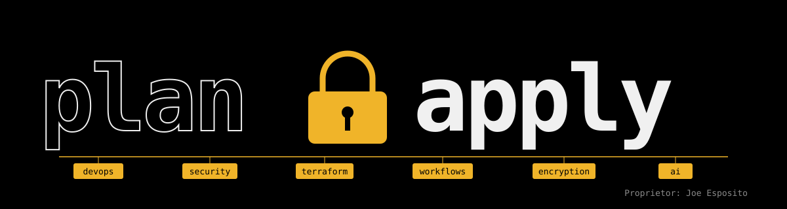

# plan-apply

> A working notebook of DevOps best practices in a Terraform environment.

This repository is new, and it is meant to stay honest about that. Instead of presenting a finished framework, it collects ideas one at a time, each one tested in a real module or workflow before it earns a place here.

## What you'll find

<b>Terraform</b>

Modules built to be reused safely: pinned providers, tested inputs, sensible defaults. The first is [`terraform-aws-s3/`](terraform-aws-s3/), a bucket module where encryption, logging, versioning and public-access blocks are on by default.

<b>Workflows</b>

GitHub Actions that take a change from pull request to apply with scanning, a saved plan and a human review in between. In progress.

<b>Security and encryption</b>

OIDC instead of long-lived keys, KMS-encrypted state, and policy gates that run before anyone reviews the plan.

<b>AI</b>

Each module carries a `CLAUDE.md` so that AI assistants follow the same conventions as contributors.

## Contributing

Issues and ideas are welcome, especially disagreements about the practices themselves. That is the point of the repo.

## License

[MIT](LICENSE)
